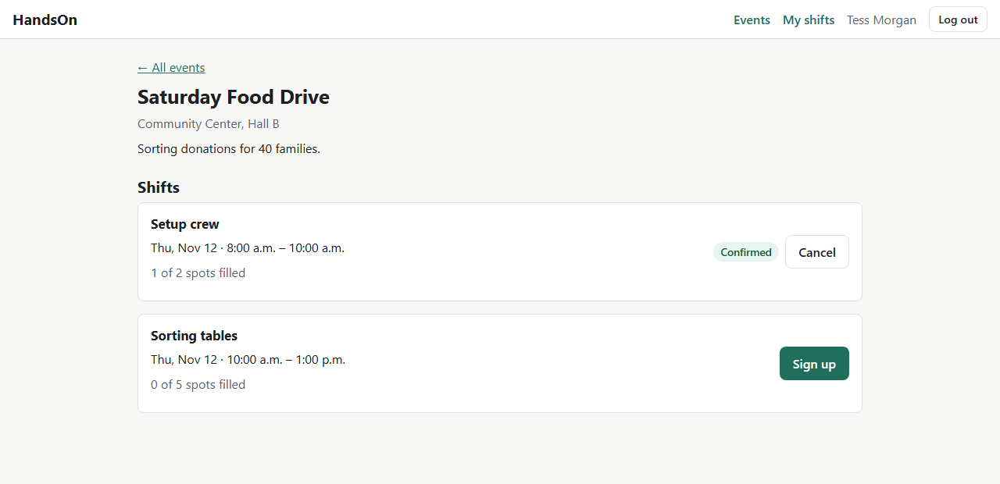
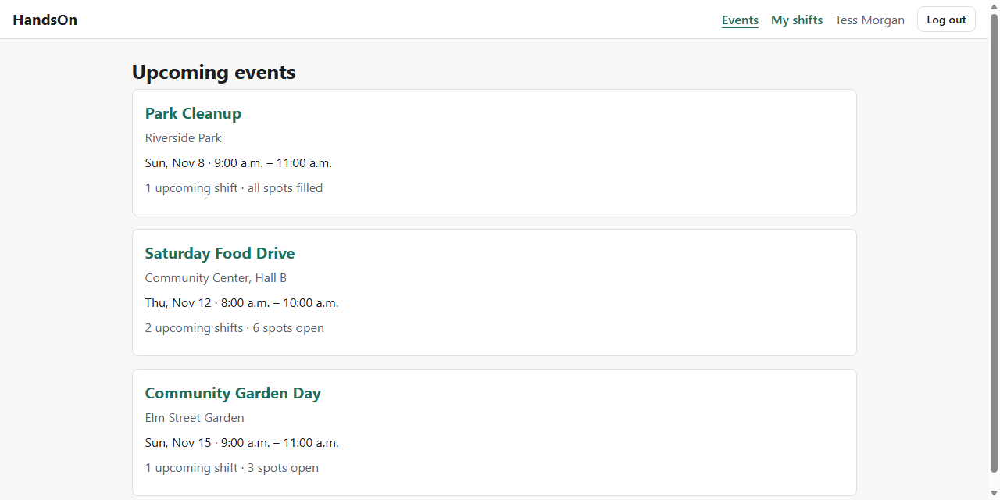
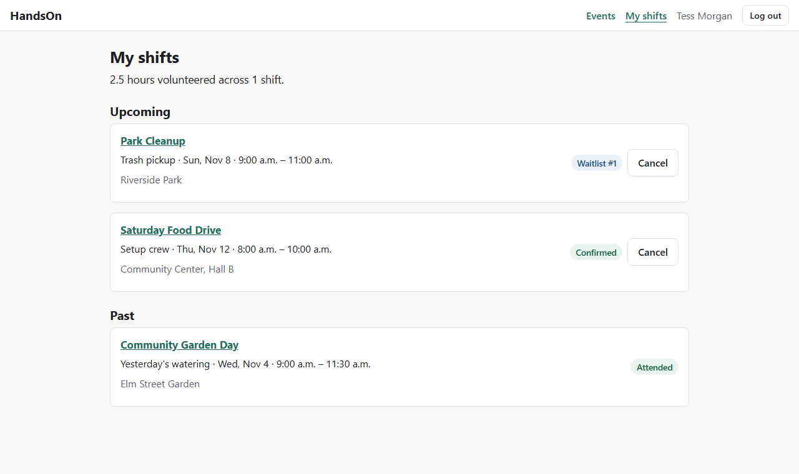
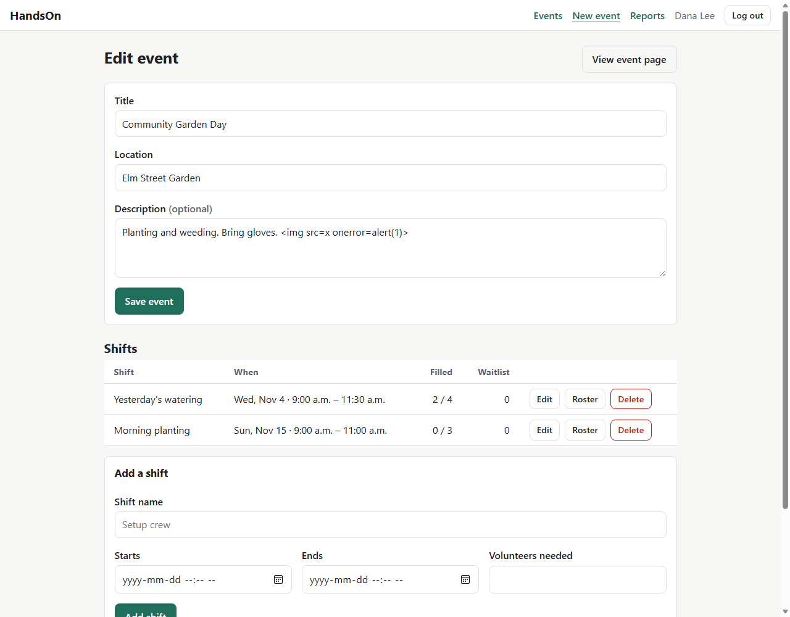
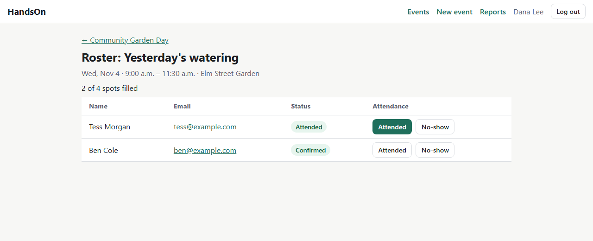
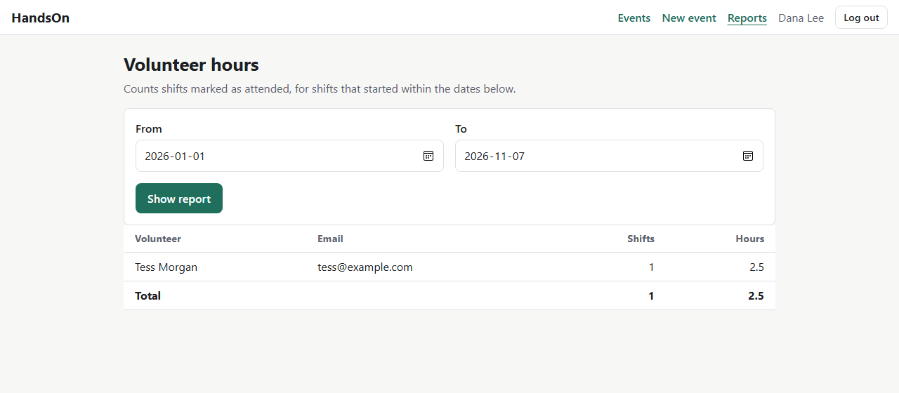
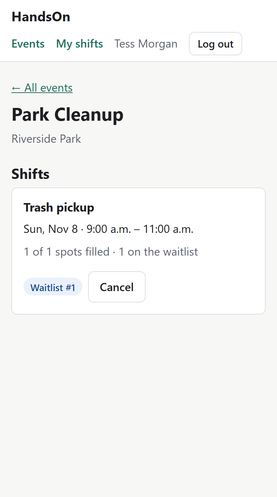

# HandsOn

[](https://github.com/MohamedAbdi6743/HandsOn/actions/workflows/ci.yml)

A volunteer shift scheduler for small nonprofits. Coordinators post events split into
shifts. Volunteers sign up, cancel, or join a waitlist when a shift is full. After a shift,
coordinators record who showed up, and the app adds up everyone's hours.

Built with Java, Spring Boot, PostgreSQL and plain TypeScript.



## Why I built it

A lot of small nonprofits run volunteer scheduling out of a shared spreadsheet and a group
chat. Shifts end up overbooked or empty, nobody knows who's on the waitlist, and when
someone needs proof of their volunteer hours (for school or a grant report), a coordinator
digs through old messages to piece it together.

HandsOn replaces that with a few rules the app enforces for everyone:

- A full shift puts you on a waitlist instead of overbooking it.
- You can't hold two shifts at the same time.
- Confirmed volunteers can't drop out within 12 hours of the start.
- When someone cancels, the next person on the waitlist gets the spot automatically.
- Hours come from attendance the coordinator actually recorded, not from sign-ups.

## Features

**Volunteers**
- Create an account and log in
- Browse upcoming events and see how full each shift is
- Sign up, join a waitlist with a visible position ("Waitlist #2"), or cancel
- "My shifts" page with upcoming and past shifts and total hours

**Coordinators**
- Create and edit events, then add, edit or remove their shifts
- See each shift's roster: confirmed people first, then the waitlist in order
- Mark volunteers as attended or no-show once a shift starts
- Hours report per volunteer for any date range

**Rules the backend enforces**
- No overbooking, even when many people sign up at the same moment (see [Concurrency](#the-hardest-part-two-people-and-one-spot))
- No signing up twice, no overlapping shifts, no joining a shift that has started
- 12-hour cancellation cutoff for confirmed spots (configurable)
- Raising a shift's capacity promotes people from the waitlist; lowering it below the confirmed count is refused
- Events and shifts with sign-ups can't be deleted

## Screenshots

| Upcoming events | My shifts |
|---|---|
|  |  |

| Coordinator: edit an event and its shifts | Coordinator: roster and attendance |
|---|---|
|  |  |

| Coordinator: hours report | Phone layout |
|---|---|
|  |  |

## Tech stack

| Part | Choice |
|---|---|
| Backend | Java 21, Spring Boot 4, Spring Web MVC, Spring Security, Spring Data JPA / Hibernate |
| Database | PostgreSQL 18, schema managed by Flyway migrations |
| Frontend | Plain TypeScript, HTML and CSS: no framework, no bundler. `tsc` compiles to browser modules |
| Tests | JUnit 5, Mockito, MockMvc, Testcontainers (real PostgreSQL in Docker) |
| Tooling | Maven Wrapper, Docker Compose for the local database, GitHub Actions CI |

## Architecture

One Spring Boot application serves both the REST API and the static pages, so the
browser talks to a single origin (no CORS setup, and session cookies just work).

```
 Browser (HTML + compiled TypeScript)
        │  fetch() with JSON, session cookie, CSRF header
        ▼
 Spring Security filter ── who is this? are they allowed?
        ▼
 Controllers   HTTP in, JSON out, @Valid request DTOs
        ▼
 Services      business rules, transactions, row locks
        ▼
 Repositories  Spring Data JPA (plus two native SQL queries for reports)
        ▼
 PostgreSQL    tables, foreign keys, unique and check constraints
```

- **Controllers** only translate HTTP. They never contain rules.
- **Services** hold every rule ("is this shift full?") and return DTOs. The database
  session closes when a service method ends (`open-in-view` is off), so nothing lazy
  leaks into the JSON layer.
- **The database** is the last line of defense: constraints reject bad data even if a
  bug slips through the Java code. There's a test suite just for those constraints.

More detail, including the design decisions and alternatives I considered, is in
[docs/ARCHITECTURE.md](docs/ARCHITECTURE.md).

### Database

```
 app_user 1 ──< event          (who created it)
 event    1 ──< shift
 app_user 1 ──< signup >── 1 shift
```

| Table | What it holds | Notable rules |
|---|---|---|
| `app_user` | Everyone who can log in | Unique lowercase email, BCrypt hash, role is `COORDINATOR` or `VOLUNTEER` |
| `event` | "Saturday Food Drive" | Created by a coordinator |
| `shift` | One time slot in an event | `end_time > start_time`, `capacity > 0` |
| `signup` | One person on one shift | One row per person per shift (`UNIQUE (shift_id, user_id)`), status is `CONFIRMED`, `WAITLISTED`, `CANCELLED`, `ATTENDED` or `NO_SHOW` |

`signup` is a full table rather than a hidden join table because it carries its own data:
the status, and when the person joined (which orders the waitlist).

## The hardest part: two people and one spot

Two volunteers click "Sign up" on a shift with one spot left at the same instant. If both
requests count "4 of 5 taken" before either saves, the shift ends up with 6 people.

Every change to a shift's sign-ups first loads the shift with
`@Lock(PESSIMISTIC_WRITE)`, which is `SELECT ... FOR UPDATE` in SQL. The second request
waits until the first transaction commits, then counts again, sees the shift is full, and
goes to the waitlist.

`SignupConcurrencyTest` checks this with real threads: ten volunteers sign up for a
three-spot shift at the same moment, and the test expects exactly three confirmed and
waitlist positions 1 to 7. To make sure the test proves something, I removed the lock and
ran it again. All ten were confirmed. With the lock back, it passes.

## Running it locally

You need **Java 21**, **Node.js** (only to compile the TypeScript) and **Docker**.
Maven isn't required; the project includes the Maven Wrapper.

1. Create your local settings file, then open it and set your own passwords:

   ```bash
   cp .env.example .env
   ```

2. Start PostgreSQL:

   ```bash
   docker compose up -d
   ```

3. Compile the frontend:

   ```bash
   cd frontend
   npm install
   npm run build
   cd ..
   ```

   While editing TypeScript, `npm run watch` recompiles on every save.

4. Start the app. Flyway creates the tables on the first start:

   ```bash
   ./mvnw spring-boot:run
   ```

   On Windows PowerShell use `.\mvnw.cmd spring-boot:run`.

5. Open http://localhost:8080 (or the `APP_PORT` from your `.env`). Log in with the
   coordinator account from `.env`, or create a volunteer account from the login page.

### Environment variables

Both Docker Compose and Spring Boot read these from `.env`, which Git ignores.

| Variable | Purpose | Example |
|---|---|---|
| `DB_PORT` | Port PostgreSQL listens on locally | `5440` |
| `DB_URL` | JDBC URL for the app | `jdbc:postgresql://localhost:5440/handson` |
| `DB_USERNAME` / `DB_PASSWORD` | Database login | |
| `APP_PORT` | Port the web app runs on | `8080` |
| `HANDSON_ADMIN_EMAIL` / `HANDSON_ADMIN_PASSWORD` | First coordinator account, created at startup if it doesn't exist (password: at least 10 characters) | |

## Tests

Docker must be running; the integration tests start their own temporary PostgreSQL.

```bash
./mvnw test
```

87 tests, and GitHub Actions runs them, plus the TypeScript build, on every push and pull request.

| Kind | Examples |
|---|---|
| Database constraints | Rejects a shift ending before it starts, duplicate sign-ups, unknown statuses |
| Unit tests (Mockito, frozen clock) | Cancellation cutoff at 11 h 59 min vs 12 h 1 min, waitlist promotion |
| API integration tests (MockMvc + PostgreSQL) | Every sign-up rule, validation messages, 401/403/404/409 responses, role rules |
| Concurrency | 10 threads racing for 3 spots |
| Security | CSRF required, session login/logout, cookie flags, Content-Security-Policy header |

I tested the frontend by hand in a browser as both roles, including phone width and an
XSS attempt (HTML typed into an event description shows up as text).

## API

All endpoints are under `/api` and use JSON. Errors always look like
`{ "status": 409, "message": "...", "fieldErrors": { ... } }`.

| Method | Path | Who | What |
|---|---|---|---|
| POST | `/auth/register` | anyone | Create a volunteer account |
| POST | `/auth/login` | anyone | Log in (form fields `email`, `password`) |
| POST | `/auth/logout` | logged in | Log out |
| GET | `/auth/me` | logged in | Current user |
| GET | `/events` | logged in | Upcoming events with shifts, counts and your own sign-up status |
| GET | `/events/{id}` | logged in | One event |
| POST / PUT / DELETE | `/events`, `/events/{id}` | coordinator | Create, edit, delete an event |
| POST | `/events/{id}/shifts` | coordinator | Add a shift |
| PUT / DELETE | `/shifts/{id}` | coordinator | Edit or delete a shift |
| POST | `/shifts/{id}/signups` | volunteer | Sign up (confirmed or waitlisted) |
| POST | `/signups/{id}/cancel` | volunteer | Cancel your own sign-up |
| GET | `/me/signups`, `/me/hours` | volunteer | Your shifts and total hours |
| GET | `/shifts/{id}/signups` | coordinator | Roster |
| PUT | `/signups/{id}/attendance` | coordinator | `{ "attended": true }` |
| GET | `/reports/volunteer-hours?from=&to=` | coordinator | Hours per volunteer |

Status codes: `400` invalid input, `401` not logged in, `403` wrong role or missing CSRF
token, `404` not found, `409` valid input that breaks a rule (full, overlapping, too late
to cancel).

## Decisions and trade-offs

- **Sessions instead of JWT.** The pages and API share one origin, so an `HttpOnly`
  session cookie is simpler and can't be read by JavaScript. The cost: sessions live in
  memory, so restarting the server logs everyone out. Spring Session JDBC would fix that
  if it ever mattered.
- **CSRF protection stays on.** Many tutorials disable it. Here the server sets an
  `XSRF-TOKEN` cookie and the frontend copies it into a header on every change request.
- **Pessimistic locking for sign-ups.** Simple to reason about ("lock the shift while
  counting") and only blocks requests for the same shift. Optimistic locking would need
  retry logic for the same result.
- **"Check, then act" for deletes.** My first version deleted an event and caught the
  database's foreign-key error. A test showed that breaks when Hibernate already has the
  shifts loaded, so the service now counts sign-ups first and refuses with a clear message.
- **Plain TypeScript, multi-page.** No framework means no router or state library to
  explain, and each page's code is short. The cost is some repeated header markup.
  A framework would start paying off with many shared interactive components.
- **Local time without time zones.** Times are stored as `TIMESTAMP` in the organization's
  local time. That's correct for one organization in one city; supporting several time
  zones would mean switching to `TIMESTAMPTZ` and converting in the browser.
- **Native SQL for the hours report.** PostgreSQL does the date arithmetic
  (`EXTRACT(EPOCH FROM end_time - start_time) / 3600`) and grouping in one query.

## What I'd add next

- Email reminders the day before a shift, and a notification when you're promoted from the waitlist
- Recurring shifts ("every Saturday 9–12")
- CSV export of the hours report
- Coordinator management in the UI (today, extra coordinators need a database change)
- Rate limiting on login attempts
- Deployment, with sessions stored in the database so restarts don't log people out

## Project layout

```
src/main/java/com/handson/
  config/       security rules, clock, first-coordinator setup
  controller/   REST endpoints
  service/      business rules
  repository/   Spring Data repositories and report queries
  entity/       JPA entities
  dto/          request and response records
  exception/    error format and global handler
src/main/resources/
  db/migration/ Flyway SQL migrations
  static/       HTML pages and CSS (compiled JS goes in static/js)
frontend/src/   TypeScript source
docs/           architecture notes and screenshots
```
